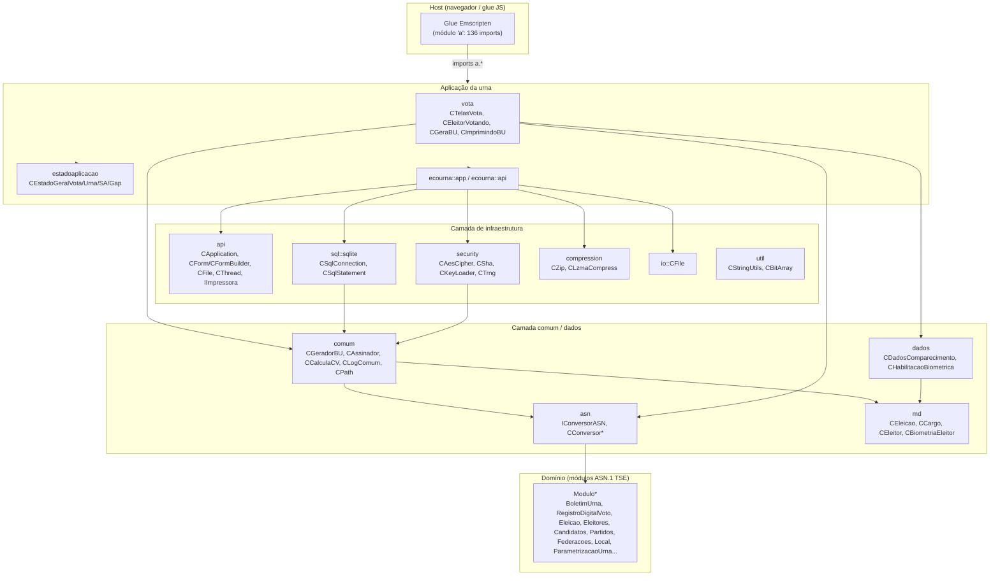

# Arquitetura — TSE VOTA (reconstruída do `vota_web_wasm.wasm`)

> Documento gerado por análise estática do módulo WebAssembly descompilado
> (`vota_web_wasm.dcmp`). O binário é um build **Emscripten minificado** de um
> projeto **C++** (sem seção de nomes), portanto os identificadores aqui foram
> recuperados das **strings de log/assert** que contêm assinaturas C++ com
> namespaces e nomes de classe. Marcas de inferência estão sinalizadas.

## 1. Visão geral

Aplicativo da **urna eletrônica (UE)** brasileira compilado para WebAssembly.
Implementa o fluxo de votação (eleitor → biometria → voto → apuração) e a
produção dos artefatos oficiais **BU** (Boletim de Urna) e **RDV** (Registro
Digital do Voto), além do suporte a **candidatos, eleitores, partidos,
federações, mesários e justificativa**.

- **Runtime:** Emscripten (C++ → wasm), com glue JS externo (136 imports do
  módulo `a`).
- **~14.343 funções** definidas, **23 exports** (API pública, minificada),
  **155 tipos** de assinatura, **4.224 segmentos de dados**.
- **Memória linear:** 414 páginas iniciais (≈26 MB), até 32.768 (≈2 GB).
- **Tabela de funções (funcref):** 12.855 slots (polimorfismo virtual C++).

## 2. Camadas / namespaces

O código se organiza em namespaces C++ aninhados, do framework (genérico) até o
domínio (urna).

```
┌─────────────────────────────────────────────────────────────────────────┐
│  Glue JS (externo)  ─  módulo "a" (136 imports) + exports Cb..Yb        │
└─────────────────────────────────────────────────────────────────────────┘
                                    ▲
┌─────────────────────────────────────────────────────────────────────────┐
│  ecourna   (app da urna)                                                 │
│    ├─ ecourna::app            (dados, asn, estados)                     │
│    └─ ecourna::api            (asn, security, sql::sqlite, io::CFile)  │
└─────────────────────────────────────────────────────────────────────────┘
                                    ▲
┌─────────────────────────────────────────────────────────────────────────┐
│  vota      (máquina de estados / telas / fluxo de votação)              │
│  estadoaplicacao (estados gerais: Vota, Urna, SA, Gap)                  │
└─────────────────────────────────────────────────────────────────────────┘
                                    ▲
┌─────────────────────────────────────────────────────────────────────────┐
│  api       (framework: aplicação, forms, arquivos, threads, impressora) │
│  comum     (base: assinatura, BU, log, DAO, pacotes, eleitores/cargos)  │
│  dados     (DTOs de dados do domínio)                                   │
│  asn       (conversores ASN.1 TSE  ↔  tipos C++)                        │
│  md        (modelos de dados: eleição, cargo, eleitor, biometria...)    │
│  sql::sqlite (persistência SQLite)                                      │
│  security  (AES, RSA, hash, HKDF, TRNG)                                 │
│  compression (CZip / LZMA)  ·  io (CFile)  ·  util (strings, bitarray)  │
└─────────────────────────────────────────────────────────────────────────┘
                                    ▲
┌─────────────────────────────────────────────────────────────────────────┐
│  Bibliotecas embutidas: SQLite · OpenSSL · Boost (regex, time, fs)     │
│  zlib/LZMA · engine de regex · QR code · pthreads (via Emscripten)     │
└─────────────────────────────────────────────────────────────────────────┘
```

## 3. Diagrama de componentes



## 4. Exportações (API pública para o JS)

A memória e a tabela são exportadas junto com 21 funções (nomes minificados):

| Export | Papel provável |
|---|---|
| `Cb` | memória linear |
| `Fb` | tabela de funções (`funcref`) |
| `Db` (`f_ueq`) | ponto de entrada principal (recebe ponteiro de contexto) |
| demais (`Eb`, `Gb`…`Yb`) | API de runtime Emscripten (`malloc`/`free`) + entry points do app |

Os 136 imports (`a.a` … `a.Bb`) são as funções do ambiente JS do Emscripten
(memória/IO do sistema, `abort`, emulação de `syscall`/`pthread`, etc.), todos
vindos de um único módulo host `a`.

## 5. Bibliotecas embutidas (ver `BIBLIOTECAS.md`)

- **SQLite** — persistência relacional.
- **OpenSSL** — criptografia (RSA-PSS, X509, ASN.1 DER, EVP).
- **Boost** — `regex`, `posix_time`, `filesystem`, `function`.
- **zlib / LZMA** — compressão (pacotes de mídia/arquivos).
- **QR code** — geração do QRCode do BU (`QRBU`).
- **pthreads** — via emulação Emscripten (threads de monitoramento).

## 6. Como ler esta documentação

- `MODULOS.md` — catálogo detalhado dos componentes/classes.
- `DADOS.md` — modelo de dados (SQL + módulos ASN.1 `Modulo*`).
- `FLUXO_VOTACAO.md` — máquina de estados e fluxo de votação.
- `BIBLIOTECAS.md` — bibliotecas embutidas e suas funções.
- `EXPORTS_IMPORTS.md` — tabela de entrada/saída do módulo wasm.
